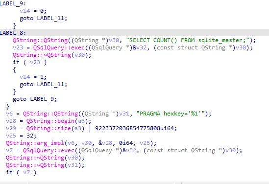
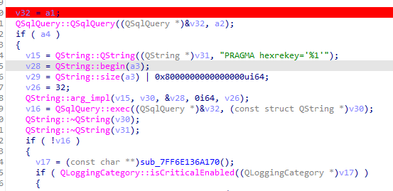
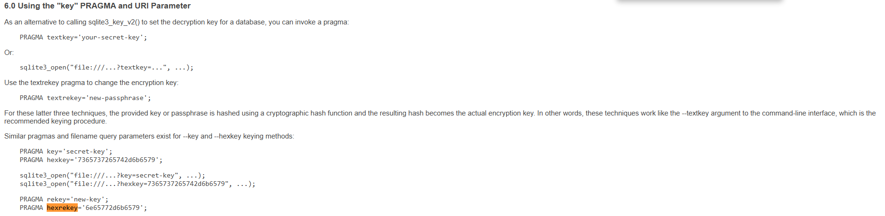
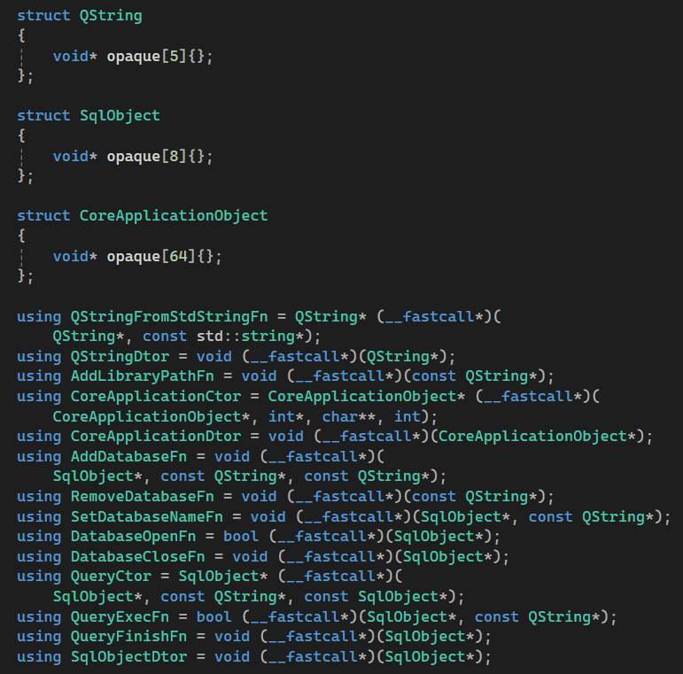

# SQLiteEncryptionExtensionEnDe
This project is intended for educational and research purposes only. Use it only with data you own or are explicitly authorized to access.

A Windows C++ project that dynamically loads QT dll and sqlite encryption extension (SEE) driver to encrypt/decrypt SQLite
databases.

The project loads `Qt6Core.dll` and `Qt6Sql.dll` at runtime from the executable directory.
After a successful x64 build, the post-build step copies all DLLs from the project folder (`Qt6Core.dll`, `Qt6Sql.dll`, and `plugins\sqldrivers\qsqlite.dll`) next to the executable.

The supplied DLLs are 64-bit; run the project as `x64`.

## Overview story
On one occasion, while reverse-engineering an OTT application—a project I undertook to pass the time, pursue a personal interest, and keep my skills sharp—I set out to discover how it encrypted its local database files. After spending some time exploring the code in IDA, I eventually identified the functions responsible for the database encryption and decryption processes.



Based on my prior knowledge, I hastily assumed it was encrypted using [**SQLCipher**](https://www.zetetic.net/sqlcipher/) because the keyword **PRAGMA hexkey**. After spending several hours testing various [**SQLCipher**](https://www.zetetic.net/sqlcipher/) configurations and searching for strings within the OTT app, I had to reluctantly accept that my initial assessment was incorrect.

After reviewing the pseudocode, I noticed that this OTT app contains a section that uses "PRAGMA rekey"—yet the SQLiteCipher library does not support the `rekey` command!



Upon further research online based on keyword `PRAGMA hexrekey`, I discovered that this is a command from the [**SQLite Encryption Extension**](https://www.sqlite.org/see/doc/release/www/readme.wiki) library, a feature that is sold for $2,000.



I decided to approach this like a reverse engineering enthusiast, looking for ways to reuse the existing DLLs and the execution flow for database operations. First, I used AI to generate a snippet of Qt code for standard database handling—covering steps such as opening a file, executing a query, and closing the file. 

From this, the functions of interest can be identified, including: **addDatabase**, **removeDatabase**, **setDatabaseName**, **close** and **open** belonging to data type **QSqlDatabase**. Additionally, the data type **QCoreApplication** is required. To execute the statements, the data type **QSqlQuery**, along with the functions **exec** and **finish**, are necessary. Since the functions from the Qt DLL are being used, it is necessary to employ **QString** for passing arguments. This requires including the **QString** type as well as functions such as **fromStdString**.



The process of loading the necessary functions requires identifying the parameters and names of the functions exported within the DLLs. This took me a bit of time, as there are quite a number of functions and data types to work with, distributed across both `Qt6Core.dll` and `Qt6Sql.dll`

Once the necessary data types and functions are obtained, I proceed to call `hexkey` then `hexrekey = ''` for the database file decryption flow. For the database file encryption flow, simply calling `hexkey` is sufficient.

## How it work
The tool will loads `Qt6Core.dll`, `Qt6Sql.dll` and initialize the necessary functions.

If the type is **folder**, a list of database files to be processed is generated from the input path folder; otherwise, the list consists of a single database file—the one specified by the input path.

If the mode is **en**, **setkey** is called to encrypt the database file. Conversely, if the mode is **de**, **rekey** is called immediately to decrypt the temporary file. 

The processing procedure will create a file backup to address errors.

## Usage
Parameters include:
- **Mode**: specifies whether the tool should run in encryption or decryption mode. Accepted values: en | de
- **Type**: specifies whether the input is a single database file or a folder containing multiple database files. Accepted values: file | folder
- **Path**: the path to the input file or folder
- **Key**: the key used for encryption or decryption. To provide a byte-based key, pass it in hexadecimal format as follows: hex:<hex_string_key>

```
SQLiteEncryptionExtensionEnDe.exe <Mode> -t <Type> -p <Path> -k <Key>

<Mode>          Mode to run
                Accepted values: en | de
<Type>          Flag define input is a single database file or a folder containing multiple database files
                Accepted values: file | folder
<Path>          The path to the input file or folder
<Key>           The key used for encryption or decryption.
                To provide a byte-based key, pass it in hexadecimal format as follows: hex:<hex_string_key>

Example:
SQLiteEncryptionExtensionEnDe.exe en -t "file" -p "D:\code_research\SQLiteEncryptionExtensionEnDe\vebir.db" -k "testkey"
SQLiteEncryptionExtensionEnDe.exe de -t "file" -p "D:\code_research\SQLiteEncryptionExtensionEnDe\vebir.db" -k "hex:746573746b6579"
SQLiteEncryptionExtensionEnDe.exe de -t "folder" -p "D:\code_research\SQLiteEncryptionExtensionEnDe\Message" -k "hex:ffefbb48cb64c23c6a4352ed1d83fc9e"
```
